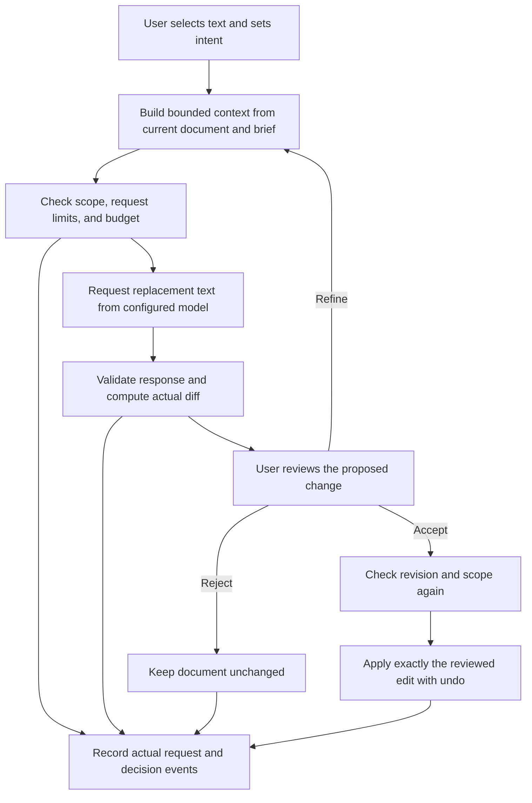

> Supporting research, not the active build contract. Start with [the project README](../../README.md).

# Chiri research for the engineering assessment

Research date: October 14, 2026. Preparation only; no app implementation, paid inference, deployment, or submission was performed.

## Decision supported by the research

**Recommendation:** Make a Markdown co-author with explicit writing context, reviewable edits, and visible AI spending. Its central experience is editing a passage, inspecting a diff, refining without losing intent, and deciding what becomes part of the document. Small context, activity, and usage surfaces should support that experience.

The earlier plan treated request usage and the change record as secondary polish. The fuller research supports including a minimal version of both in the planned core. It also supports keeping durable document context separate from the messages sent to a model. These additions must earn their place through usefulness and remain subordinate to the editor.

This is an assessment-sized interpretation of Chiri's documented principles. It is not a reconstruction of Chiri Brain, an undisclosed hiring rubric, or a guarantee of an offer. The assessment remains the authority on deliverables and scope.

## Research coverage and evidence quality

| Collection | Coverage in this research | Limits |
| --- | --- | --- |
| Local company screenshots | Reviewed extracted text for all 69 screenshots across Mainpage, About, Chiri Brain, Ontology, Harness/Governance, Spend Optimization, and Agentic Engineering. Cross-checked important original images, including governance attribution, routing criteria, human checkpoints, and company beliefs. | OCR has errors, especially diagram text. Original images take precedence. This turn did not visually re-inspect every screenshot individually. |
| Local field guides | Read all extracted text of all three guides: Ontology, 26 pages; AI Harness, 21; AI Governance, 22. Inspected relevant rendered diagrams, including context graphs, guides/sensors, provenance records, and the governance foundation. | The guides establish Chiri's framing. Their market statistics, legal timelines, and comparisons are not independently proven by appearing in a guide. |
| Role and engineer material | Reviewed the job description, colleague profile, and existing role/experience analysis. | Rodrigo's stack is an example of Chiri work, not a mandatory assessment stack or Eduardo's experience. |
| Current company website | Reviewed homepage, platform, solutions overview, Ontology, Harness/Governance, Spend Optimization, Field Guides, Tokenmaxxing, and Atlas overview. Local material covers the Agentic Engineering page. | Atlas was reviewed as a directory/product surface; its hundreds of vendor reports were not individually researched. |
| Company articles | Screened the 60-entry blog index and read 21 directly relevant articles in detail; see the register below. Also reviewed retrieved CEO writing on culture, harness value, and outcome measurement. | This is comprehensive research for the assessment decision, not a claim to have read every article or every external work in every bibliography. |
| CTO interviews | Reviewed four company-published interview-based articles and the complete auto-caption transcript of a 45:27 original panel. Verified participants and upload date in the video's expanded description. | Auto-captions corrupt names and technical terms. The written interviews are edited publications; their raw interview recordings were not located. Do not assume all four came from the panel. |
| Implementation feasibility | Checked current primary OpenRouter documentation on usage, key limits, privacy, routing, and caching. | No key was accessed and no model was benchmarked. Model choice and editor feasibility remain implementation-preparation decisions. |

Local source IDs resolve through [the catalog](<source-catalog.md>). Existing synthesis is in [the company master](<../../private/preparation-originals/01_CHIRI_MASTER.md>). It helped navigate the originals; it is not additional independent evidence.

**Evidence labels:** **Documented** means a supplied source or public company publication states it. **Inference** means our interpretation. **Proposal** means a product/development choice. **Unverified claim** means a source assertion whose underlying measurement or mechanism was not established here.

## 1. Context means current meaning, sources, and decision history

**Documented:** The Ontology guide distinguishes definitions/rules from populated instances and from text retrieval. It describes business entities, relationships, provenance, temporal validity, and decision history. Its practical starting point is a narrow set of questions the system must answer, rather than modeling an entire company. Relevant pages: 6-13, 17, 19-24. Source: [Ontology Field Guide](<../../private/source-materials/Guides/chiri-field-guide-ontology.pdf>).

The CTO's interview explains continuous ingestion and enrichment, warns about poor source data, and recommends a bounded diagnosis before a large cleanup. The newer comparison article emphasizes agreed definitions and source coverage. These show why merely passing more text is an incomplete response to context. Sources: [CTO ontology interview](https://chiri.ai/blog/what-an-ontology-actually-is-and-why-it-decides-ai-output-quality), [meaning versus storage](https://chiri.ai/blog/knowledge-graph-vs-vector-database-vs-ontology).

**Inference for the editor:** Context should have identifiable roles: the current document, the selected passage, the user's purpose/audience, explicit constraints, and the current proposal's refinement state. Accepted writing and rejected suggestions cannot be treated as interchangeable knowledge. A document edit creates a new revision, so a proposal's context has a lifetime.

**Proposal:** Provide a small optional writing brief, initially audience/purpose and writing constraints. Keep it in application-owned document state, editable by the user. Include only relevant current context in requests. A selection edit can receive its heading and bounded surrounding text for coherence. Show the distinction between the passage AI may change and the surrounding context it may read.

**Proposal:** Retain active refinement instructions such as warmer, shorter, preserve the figures. An explicit change can supersede an earlier preference. Start a fresh proposal clearly. Do not replay an unbounded global chat or silently infer permanent preferences from rejection.

**Limit:** These fields are structured document context, not a full ontology or verified source-of-truth service. The app cannot prove that prose is factually true merely because it was supplied as context.

## 2. Governance includes prevention and a reconstructable record

**Documented:** Chiri's governance pages describe pre-execution checks, before/after records, scoped access, and fail-closed behavior. The Governance guide distinguishes a model's explanation from independent records of what occurred, when, and under whose authority. Relevant pages: 6-9, 11-12, 17-19. Sources: [Governance Field Guide](<../../private/source-materials/Guides/chiri-field-guide-ai-governance.pdf>), local B03/B05 and H01-H13.

In the published governance interview, Wimberly names five practices: current data schemas, data classification, employee-equivalent access, cost quotas, and reviews of failures/prompting. His point combines access, spending, and learning from incidents. Source: [governance interview](https://chiri.ai/blog/what-real-ai-agent-governance-looks-like-in-practice).

**Proposal:** AI gets one bounded capability: propose replacement text for a captured scope. Application code validates the response. Only a user acceptance can commit it. A stale revision or invalid scope prevents application. No model-generated range, identifier, or approval flag can authorize broader edits.

**Proposal:** Maintain a compact activity record from real application events: request/proposal ID, document revision, affected scope, instruction, before/after text, requested/returned model, timing, usage when known, and decision status. Refining, accepting, rejecting, invalidating, and undoing should be distinguishable. Detailed records belong behind a small disclosure, not across the writing canvas.

**Limit:** A record in browser memory or local storage is useful session history, not an independently trustworthy immutable audit log. A client can alter it. Hash chaining alone does not establish integrity against a party able to rewrite the whole chain. We should describe the actual guarantee, without compliance badges or invented identities in a no-auth demo.

## 3. Spending is governed by task value and quality

**Documented:** The Spend Optimization page combines cost, capability, latency, and data boundary requirements. It distinguishes coding workloads from routine document work and says routing must preserve governance. Local X01-X08 and the [current spend page](https://chiri.ai/solutions/token-optimization) support this directly.

Chiri's spending articles emphasize completed work, the expense of failed attempts, and a fixed quality bar when moving work to a cheaper model. The Tokenmaxxing calculator illustrates assumptions rather than audited customer savings. Sources: [Cheaper Tokens, Bigger Bills](https://chiri.ai/blog/cheaper-tokens-bigger-bills), [The Casino Chip Economy](https://chiri.ai/blog/the-casino-chip-economy), [calculator and assumptions](https://chiri.ai/tokenmaxxing).

**Inference:** A prominent token counter without outcome context would only partially reflect their position. Cheap calls that require repeated correction can cost more in money and user attention. An impressive answer that consumes the supplied $5 carelessly also misses an explicit constraint.

**Proposal, planned core:**

- One purposeful inference call per user request/refinement. Acceptance, rejection, undo, diff calculation, scope validation, and local history use no model calls.
- Bounded input and output, a limited refinement history, protection against duplicate submissions, one active request, and no endless repair/retry loops.
- A discreet request cost/usage result plus session spending. Record provider-reported usage; label preflight estimates and unknown usage honestly. Cancelled or failed requests may still cost money.
- Check the supplied key's remaining allowance server-side when needed. Its provider limit is the shared-budget backstop. A resettable browser counter cannot enforce a shared $5 cap.
- Use a server-controlled model configuration/allowlist and preserve privacy restrictions across any provider fallback. Budget availability must not silently authorize a more expensive retry.

**Proposal, model selection:** Establish a handful of representative edit cases and compare one economical candidate with one stronger reference under the same context and requirements. Choose the least expensive option that meets the writing and reliability bar. No paid comparison is part of this research. If two task profiles later show a clear benefit, a small deterministic mapping is enough; an LLM classifier and a large model picker are not necessary to demonstrate judgment.

**Proposal, outcome measurement:** Start with actual spending, latency, requests, and decisions. A later useful measure is total inference cost divided by retained accepted edits, including spend on rejected and superseded candidates in the numerator. With no retained accepted edits, the value is unavailable, not zero. Acceptance is only a user-approval proxy; it does not prove business ROI or factual correctness. Do not invent money saved or a comparison baseline.

## 4. Keep context independent of model providers

**Documented:** Chiri frames the map, harness, and record as durable assets around an interchangeable model. The model-agnosticism article proposes checkable portability practices and explicitly says they were a proposal, rather than an already signed coalition. Sources: local FG-O p21, FG-H p17, FG-G p18; [Model Agnosticism Principles](https://chiri.ai/blog/the-model-agnosticism-principles).

**Proposal:** Store Markdown, writing brief, proposal state, and activity in an application-owned shape. Keep provider response formats at a narrow integration boundary. A model change should not discard the user's writing or preferences.

**Limit:** A shared API makes integration easier; it does not prove behavioral interchangeability. Different models may handle Markdown, constraints, structured responses, and refinement differently. A model swap needs the same acceptance cases, and OpenRouter remains a gateway dependency. We should not claim zero switching cost.

## 5. A harness needs feedback as well as instructions

**Documented:** The Harness guide distinguishes guides that steer a model before action from sensors that check what happened. It explicitly prioritizes context relevance/compaction, instrumentation, feedback, and the layer a team can control over rebuilding a runtime. Relevant pages: 8-12 and 17-19. Source: [AI Harness Field Guide](<../../private/source-materials/Guides/chiri-field-guide-ai-harness.pdf>).

The Completion Standard article argues for defining completion before implementation and discusses deterministic validators as a reusable alternative to repeated model-based checking. It also admits that the validator itself needs scrutiny. Source: [The Completion Standard](https://chiri.ai/blog/the-completion-standard).

**Proposal:** Define the editor's behavioral acceptance criteria before coding. Validate scope, revision, response shape, actual application, rejection, and undo with ordinary code and browser checks. Evaluate tone, coherence, and preservation of meaning with a few representative real-model examples and human review. Passing a schema check cannot certify writing quality.

**Important boundary:** Their blog contains both multi-agent recommendations and warnings about splitting evidence. Neither is a requirement to add agents to this app or to our development process. Eduardo's instruction is to use one reasoning agent. We can use explicit standards, narrow tasks, tests, and human review without delegation.

## 6. Reduce the human work around AI

**Documented:** The AI Tax article asks teams to measure total human workflow time, including review and cleanup. The Human Rate Limit article treats review capacity as a constraint and advocates review infrastructure and bounded changes. The Trust Ledger argues that affected people should be able to inspect an agent's authority and actions. Sources: [AI Tax](https://chiri.ai/blog/the-ai-tax-are-your-new-tools-secretly-making-your-team-busier), [Human Rate Limit](https://chiri.ai/blog/the-human-rate-limit), [Trust Ledger](https://chiri.ai/blog/the-trust-ledger).

**Proposal:** Keep the document and the current diff central. Place short instructions/refinements beside the passage. Make it easy to inspect exactly what changed without comparing two whole documents mentally. Show context, activity, and usage on demand. Avoid mandatory administrative forms or a dashboard that becomes the main product.

**Inference:** A substantial sidebar chat that makes the user copy prose back into the document creates the kind of workflow friction Chiri criticizes. A tiny attached refinement input can support conversation while keeping the work inside the document.

## 7. Ownership includes retention boundaries and recoverability

**Documented:** The CISO's security checklist covers model location, prompts/outputs, retention, injection, scoped tools, secret handling, quotas, and testing. His change/rollback article emphasizes recovery and graceful degradation. Sources: [security checklist](https://chiri.ai/blog/ai-security-overview-of-critical-must-haves), [change and rollback](https://chiri.ai/blog/output-over-everything-a-cisos-field-guide-to-change-testing-and-rollback).

**Proposal:** Keep the API key server-side. Treat document content as untrusted input, separate it from the user's instructions, and give the model no arbitrary tool execution. Use safe Markdown rendering and test malicious HTML/links if preview is included. Retain the document when the provider is unavailable. Make undo and local save/export clear enough that a failed request is not a loss of writing.

**Proposal:** Explain which text is sent for an edit. Keep operational logs to metadata unless content is needed for an explicit local history feature. Use fictional demonstration text. If the supplied key and chosen provider support appropriate retention/data-collection restrictions, enforce them consistently; otherwise document the actual data path and limits. Do not promise Chiri's contractual protections for our independent demo.

**Limit:** Local history, local persistence, server logs, model-provider retention, and caching are different stores with different lifetimes. A zero-retention provider route does not imply our app stores nothing. Clearing browser data does not erase a provider's past handling of a request.

## 8. Delivery and the AI development transcript

**Documented:** SCOUT emphasizes understanding, candor, ownership, human judgment, and precision. The pods interview describes short cycles of visible work with business and engineering context together. The Vibe Coders article describes the failure of accepting suggestions without understanding what is needed. Sources: [job description](<../../private/preparation-originals/Job-Description.MD>), [pods interview](https://chiri.ai/blog/pods-not-departments-how-chiri-structures-ai-delivery-work), [Vibe Coders](https://chiri.ai/blog/the-vibe-coders-are-not-okay).

**Proposal:** The transcript should document the real process: requirements, relevant research, choices and trade-offs, small changes, checks, mistakes, and corrections. Eduardo should understand the consequential decisions and challenge suggestions where needed. The record should not be scripted to simulate confidence or company alignment.

**Proposal:** Preserve authentic implementation sessions from the start and commit them as the assessment requires. Keep this research as supporting preparation if useful. A retrospective decision summary can help reviewers navigate a genuine session; it cannot replace it. Redact credentials and private data without rewriting the reasoning history to remove ordinary uncertainty or errors.

## 9. What the original panel adds

[Why Your AI Bill Is About to Explode & How to Control It](https://www.youtube.com/watch?v=wVWbrp30Vzc), IgniteGTM, uploaded August 20, 2026, duration 45:27. The organizer's expanded description identifies Matthew Wimberly, Davy Wong, Eugene Shih, and moderator Bill Barry. The [organizer recap](https://blog.ignitegtm.com/p/takeaways-from-the-sillicon-valley-ai-tour-bay-area-startups-collectively-secured-2-1b-in-august-wee-4a6d) dates the event August 14, 2026.

Relevant Wimberly segments, paraphrased from auto-captions:

| Timestamp | Point relevant to this assessment |
| --- | --- |
| [8:05](https://www.youtube.com/watch?v=wVWbrp30Vzc&t=485s) | Forecasting spending and establishing workflow value begin at project inception. |
| [12:33](https://www.youtube.com/watch?v=wVWbrp30Vzc&t=753s) | Evaluate actual workload needs, then move toward cheaper options with evidence; retain traceability and quotas. |
| [17:10](https://www.youtube.com/watch?v=wVWbrp30Vzc&t=1030s) | Fit software around the work and reduce fragmented interfaces. |
| [20:05](https://www.youtube.com/watch?v=wVWbrp30Vzc&t=1205s) | Shadow AI signals an unmet workflow need as well as data risk. |
| [29:16](https://www.youtube.com/watch?v=wVWbrp30Vzc&t=1756s) | Keep organizational memory separate from a provider so accumulated context survives a change. |
| [33:46](https://www.youtube.com/watch?v=wVWbrp30Vzc&t=2026s) | Capturing tacit workflow knowledge can help existing staff take over work. |

The auto-caption transcript was reviewed for research; it is not Eduardo's AI development transcript. Names such as Chiri and Wimberly are mistranscribed in places. Use the verified description and context for attribution; do not present captions as exact quotations. The source links and timestamps above support review without reproducing the full transcript here.

## 10. Nuance, contradictions, and claims we should not copy

1. **Writing context is not automatically an ontology.** In the digital-twin interview Wimberly says brand-voice writing can work with a single prompt and does not require an ontology. That supports modest explicit context for this editor. Source: [digital-twin interview](https://chiri.ai/blog/where-digital-twins-come-in-from-a-wastewater-plant-to-company-memory).
2. **More agents are not a universal quality signal.** The Completion Standard and Vibe Coders pieces discuss role separation; Hidden-Profile warns about fragmented evidence. The transferable lesson is to organize information and verification deliberately. Their cited benchmark results are not evidence that this editor needs multi-agent orchestration. Source: [Hidden-Profile](https://chiri.ai/blog/the-hidden-profile-problem).
3. **Retention statements need current verification.** Around 28:58 the panel makes a blanket statement about OpenRouter not providing zero data retention. Current OpenRouter documentation exposes ZDR and data-collection controls. Do not copy the panel statement as a current universal fact. Controls depend on eligible routes and account/request configuration. Source: [OpenRouter privacy/routing documentation](https://openrouter.ai/docs/guides/get-started/sovereign-ai).
4. **Caching and privacy can conflict.** Provider prompt caching and OpenRouter response caching are different features. Account-level ZDR disables OpenRouter response caching; prompt-cache eligibility and retention interpretation vary. An optimization must be tested against the selected privacy policy. Sources: [response caching](https://openrouter.ai/docs/guides/features/response-caching), [prompt caching](https://openrouter.ai/docs/guides/best-practices/prompt-caching).
5. **Current documentation supersedes older API examples.** OpenRouter now includes usage automatically; older announcements show an opt-in flag that the current documentation marks deprecated. Source: [current usage accounting](https://openrouter.ai/docs/cookbook/administration/usage-accounting).
6. **Simplification is a theme; absolute claims need restraint.** The calculator says the flat-rate era ended, while Per-Seat Pricing Is Back discusses when cheap models make flat pricing viable again. Read these as scenario-dependent economics. Do not treat marketing price examples as a current rate card. Source: [Per-Seat Pricing](https://chiri.ai/blog/per-seat-pricing-is-back).
7. **Source-grounded does not mean infallible.** Claims such as an ontology ending guessing, zero switching cost, and immutable trust require operational evidence. We can honor the principles without repeating absolute guarantees.
8. **No inferred compliance certification.** Chiri's material distinguishes readiness/mapping from completed audits in places. We should make no HIPAA, SOC 2, or regulatory-compliance claim for a small editor.
9. **The October 20 webinar is after our deadline.** The current Field Guides page advertises October 20. Some older indexed material mentions September 22. We do not assume an event occurred, was rescheduled, or has a replay without evidence. The August panel is the verified existing recording. Source: [Field Guides page](https://chiri.ai/field-guides).
10. **Hiring preference remains an inference.** The assessment explicitly prioritizes experience, integration, AI-assisted delivery, code quality, and judgment. The company material helps interpret those criteria; it does not authorize adding enterprise infrastructure to the requested showcase.

## 11. Proposed product scope after research

| Priority | Planned capability | Why it earns its place |
| --- | --- | --- |
| Core | Markdown writing with a prebuilt editor | Direct requirement; gives the evaluator a familiar work surface. |
| Core | Selection edit and explicit scope; document-wide scope only through an explicit action and size bound | Useful collaboration and a clear authority boundary. |
| Core | Tracked diff in/adjacent to the passage | Makes review understandable and reduces comparison work. |
| Core | Accept, reject, refine, and undo | Human control and a complete editing loop. |
| Core | Optional compact writing brief; retained refinement intent | Demonstrates useful context without a knowledge platform. |
| Core | Validation and stale/superseded-response handling | Makes the proposal/commit boundary real. |
| Core, minimal UI | Session activity entries from actual actions | Shows what was requested, proposed, and decided. |
| Core, minimal UI | Request usage/cost, session spend, and server/provider budget controls | Demonstrates measured spending within the supplied cap. |
| Core | Sample document, useful failures, straightforward setup, authentic development sessions | Makes the product immediately reviewable and the submission complete. |
| After core validation | Local save/export, richer activity inspection, keyboard polish, model comparison presentation | Useful handover and usability improvements if time remains. |
| Defer | Large model picker, autonomous routing classifier, broad memory extraction, RAG/graph infrastructure, multiplayer, enterprise permissions, immutable ledger platform | Each adds a separate system beyond the focused assessment. |

Suggested interaction layout: one primary document canvas, a contextual instruction/refinement surface, and a compact details drawer for writing context, changes, and usage. Do not open with three dashboards. Let the first successful edit introduce the product.

### Proposed flow and boundaries

This is a design sketch, not app code or a finalized architecture.

## 12. Quality and spending evaluation before declaring it ready

Define expected behavior first. Use deterministic fixtures for most application checks and a small real-model set for language quality. The table is a proposed evaluation plan, not completed test evidence.

| Case | Success criterion |
| --- | --- |
| Context relevance | The edit respects the supplied audience/purpose and uses sufficient surrounding context. Unrelated prior history does not enter the request. |
| Refinement continuity | Warmer, then shorter retains warmth and explicitly requested details. An explicit new tone replaces the prior preference. |
| Precision of scope | Repeated paragraphs or moved focus cannot cause the wrong passage to change. |
| Review/application agreement | Acceptance commits exactly the reviewed candidate. Rejecting or refining does not mutate committed text. |
| Revision safety | A delayed, superseded, or stale response cannot overwrite newer writing. |
| Markdown | Lists, headings, links, and code fences remain usable. Required code/identifiers remain unchanged when the instruction demands it. |
| Boundary attack | Text inside the document asking to ignore instructions or edit elsewhere cannot grant application privileges. Human review still checks the meaning of the in-scope output. |
| Recovery | Undo works; provider failure leaves writing intact; an exhausted allowance yields a useful state. |
| Evidence | Activity reflects actual requests and decisions, including failed/invalidated proposals; no model-authored narrative substitutes for events. |
| Spending | Usage is reconciled where available. Duplicate clicks and repeated local actions do not create inference calls. Unknown cost is not reported as zero. |
| Human effort | A reviewer can complete the first edit/refinement without documentation or manual copy/paste. The review burden is reasonable for the change. |
| Handover | Fresh setup works from the README; the code and transcript support Eduardo's explanation of the important decisions. |

Reserve part of the $5 for final evaluator/demo use. Set the live evaluation allowance before paid calls and stop at that allowance. A few cases help choose a model; they do not establish a general model ranking or production reliability.

## 13. Public source register

All sources below were accessed October 14, 2026 through the web reader, browser, or publicly indexed text. Dates are publication/update labels when visible, not assumed interview dates. Summaries are deliberately brief; links support further review without reproducing articles.

### Company articles read in detail

| Article | Published / updated when verified | Main research use |
| --- | --- | --- |
| [Knowledge Graph vs Vector Database vs Ontology](https://chiri.ai/blog/knowledge-graph-vs-vector-database-vs-ontology) | Oct 6 / Oct 6, 2026 | Distinguish meaning, retrieval, and storage; avoid an infrastructure-first response to context. |
| [Pods, Not Departments](https://chiri.ai/blog/pods-not-departments-how-chiri-structures-ai-delivery-work) | Sep 1 / Sep 8, 2026 | Interview-based; business context and short visible delivery cycles. |
| [Real AI Agent Governance](https://chiri.ai/blog/what-real-ai-agent-governance-looks-like-in-practice) | Sep 1 / Sep 8, 2026 | Interview-based; five operational practices including quotas and failure review. |
| [Digital Twins and Company Memory](https://chiri.ai/blog/where-digital-twins-come-in-from-a-wastewater-plant-to-company-memory) | Sep 1 / Sep 8, 2026 | Interview-based; continuity, work history, and limits of the ontology analogy for style edits. |
| [Cheaper Tokens, Bigger Bills](https://chiri.ai/blog/cheaper-tokens-bigger-bills) | Sep 1, 2026 in indexed publication | Cost of finished work and failed attempts; narrow scope and fixed quality bar. |
| [Why Everyone Is Talking About an AI Harness](https://chiri.ai/blog/why-everyone-is-talking-about-an-ai-harness-and-what-you-need-to-know) | Sep 1 / Sep 8, 2026 | Concrete boundaries and ownership of system handoffs. |
| [The Completion Standard](https://chiri.ai/blog/the-completion-standard) | Sep 1 / Sep 8, 2026 | Define completion and validate; do not continually pay a model to run a deterministic check. |
| [Per-Seat Pricing Is Back](https://chiri.ai/blog/per-seat-pricing-is-back) | Sep 1 / Sep 4, 2026 | Pricing depends on actual workload economics; avoid blanket conclusions about subscriptions. |
| [The Trust Ledger](https://chiri.ai/blog/the-trust-ledger) | Sep 1 / Sep 4, 2026 | Visibility for the person affected by AI actions. |
| [What an Ontology Actually Is](https://chiri.ai/blog/what-an-ontology-actually-is-and-why-it-decides-ai-output-quality) | Sep 1 / Sep 8, 2026 | Interview-based; continuous context and bounded data diagnosis. |
| [Isolation Is a Setting](https://chiri.ai/blog/isolation-is-a-setting) | Sep 1 / Sep 4, 2026 | Chiri's containment/ownership argument; incident statistics remain attributed claims. |
| [The Hidden-Profile Problem](https://chiri.ai/blog/the-hidden-profile-problem) | Sep 1 / Sep 4, 2026 | Chiri's warning about fragmented evidence; do not equate agent count with quality. |
| [The Vibe Coders Are Not Okay](https://chiri.ai/blog/the-vibe-coders-are-not-okay) | Aug 18 / Sep 4, 2026 | Understand suggestions and validate; general production advice is not an assessment feature list. |
| [The Model Agnosticism Principles](https://blog.chiri.ai/the-model-agnosticism-principles/) | Aug 16, 2026 in retrieved publication | Portability as a checkable practice and an explicitly proposed commitment. |
| [Your Private Brain](https://chiri.ai/blog/your-private-brain) | Aug 15 / Sep 4, 2026 | Chiri's stance on proprietary context and contractual boundaries; technical claims need separate evidence. |
| [The Human Rate Limit](https://chiri.ai/blog/the-human-rate-limit) | Aug 9 / Sep 4, 2026 | Human review capacity; small changes and useful automated checks. |
| [The Death of the Status Call](https://chiri.ai/blog/the-death-of-the-status-call) | Aug 6 / Sep 4, 2026 | Tie visible delivery to real actions and cost. |
| [The Casino Chip Economy](https://chiri.ai/blog/the-casino-chip-economy) | Aug 4 / Sep 8, 2026 | Workload-sensitive spending and protection of proprietary context. |
| [Output Over Everything](https://chiri.ai/blog/output-over-everything-a-cisos-field-guide-to-change-testing-and-rollback) | Oct 31, 2025 / Sep 4, 2026 | CISO-authored; recoverability and observable operating behavior. |
| [AI Security: Critical Must Haves](https://chiri.ai/blog/ai-security-overview-of-critical-must-haves) | Sep 17, 2025 / Sep 4, 2026 | CISO-authored; data flows, retention, scope, secrets, quotas, and testing. |
| [The AI Tax](https://chiri.ai/blog/the-ai-tax-are-your-new-tools-secretly-making-your-team-busier) | Jul 9, 2025 / Sep 4, 2026 | Total human workflow effort and the review/approval last mile. |

### Other primary company and founder sources

- [Homepage](https://chiri.ai/), [platform](https://chiri.ai/platform), [solution overview](https://chiri.ai/solutions), [Ontology](https://chiri.ai/solutions/ontology), [Harness/Governance](https://chiri.ai/solutions/harness), [Spend Optimization](https://chiri.ai/solutions/token-optimization), [Field Guides](https://chiri.ai/field-guides), [Tokenmaxxing](https://chiri.ai/tokenmaxxing), and [Atlas overview](https://chiri.ai/chiri-atlas).
- [Blog index](https://chiri.ai/blog): 60 article entries screened; entries not in the detailed register were not treated as fully read articles.
- [Mathew Caldwell: compass and speedometer](https://www.linkedin.com/pulse/every-ai-deployment-needs-compass-speedometer-most-have-caldwell-7maac), June 22, 2026: retrieved author text ties sources, standards, boundaries, and proof to outcome measurement.
- [Mathew Caldwell: when intelligence gets cheap](https://www.linkedin.com/pulse/when-intelligence-gets-cheap-what-expensive-mathew-caldwell-jgw2c): retrieved author text argues value moves toward judgment, context, architecture, and taste.
- [Mathew Caldwell: companies, culture, relationships, and workflows](https://www.linkedin.com/pulse/companies-built-culture-workflows-mathew-caldwell-qge9c), June 8, 2026: retrieved author text connects adoption to organizational work rather than tool purchases.

### Original panel and organizer

- [Panel recording](https://www.youtube.com/watch?v=wVWbrp30Vzc): participant list and August 20 upload date verified in the expanded description; complete auto-caption transcript reviewed.
- [Organizer event recap](https://blog.ignitegtm.com/p/takeaways-from-the-sillicon-valley-ai-tour-bay-area-startups-collectively-secured-2-1b-in-august-wee-4a6d): August 15 publication describing the August 14 event. Useful corroboration of event context, not evidence that every panelist shares every statement.
- [Organizer video library](https://www.youtube.com/@IgniteGTM/videos): used to locate the original panel rather than infer its contents from promotional posts.

### Current OpenRouter references checked

- [Usage accounting](https://openrouter.ai/docs/cookbook/administration/usage-accounting): usage, cost, reasoning, and cache fields; streaming/non-streaming placement; deprecated opt-in flags.
- [Current key information](https://openrouter.ai/docs/api/api-reference/api-keys/get-current-key): key-specific usage, limit, and remaining allowance; no key was queried during research.
- [Guardrails](https://openrouter.ai/docs/guides/features/guardrails/overview): limits, allowlists, and privacy policy controls; does not imply permissions to modify the supplied account.
- [Privacy/routing controls](https://openrouter.ai/docs/guides/get-started/sovereign-ai): ZDR and data-collection routing restrictions; provider eligibility matters.
- [Prompt caching](https://openrouter.ai/docs/guides/best-practices/prompt-caching): model/provider behavior, thresholds, and sticky routing. Do not pad a short prompt merely to qualify for caching.
- [Response caching](https://openrouter.ai/docs/guides/features/response-caching): distinct from prompt caching; retention, identical-request behavior, and account-level ZDR incompatibility.
- [Auto Router](https://openrouter.ai/docs/guides/routing/routers/auto-router): routing and session behavior were reviewed as available options, not selected as the app's default architecture.

## Remaining preparation decisions

The research now establishes a product rationale. The remaining work is focused: settle the editor's feasible diff interaction, choose the fastest maintainable stack Eduardo understands, define the concrete acceptance cases, establish authentic implementation-session export, and choose model candidates under an explicit live-test allowance. None of those require starting app implementation in this turn.
